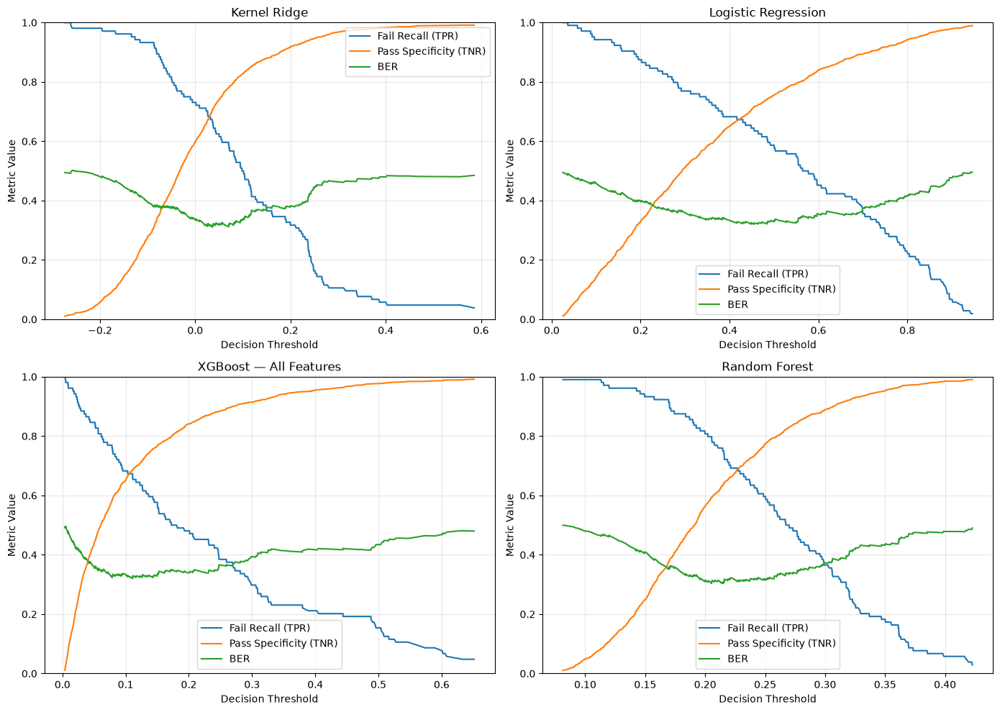

# Semiconductor Manufacturing Risk Ranking with SECOM

A notebook-based study of failure-risk ranking on public semiconductor process data. The emphasis is on leakage-aware evaluation, investigation workload, and the limits of retrospective analysis—not a claim of production yield improvement.

## Results at a glance

- 1,567 samples, 590 measured feature columns, 104 failures (6.64%).
- Stratified ten-fold cross-validation; preprocessing fitted separately inside training folds.
- Compared Kernel Ridge, Logistic Regression, Random Forest and XGBoost.
- XGBoost with all features: average precision **0.1781**, ROC-AUC **0.7265**. Random Forest had the highest ROC-AUC among these saved comparisons (**0.7457**); there is no single winner on every criterion.
- The separate **Random Forest OOF investigation-budget analysis** flags 314 samples (20.04%), covering 53 of 104 failures (**50.96% recall**), with **261 false alarms** and **16.88% precision**. These are review priorities, not validated production alerts.

Sources: [model comparison](reports/chapter5_ranking_metrics.csv) and [investigation budgets](outputs/chapter_07/investigation_budget_table.csv). Different model and operating-point results must not be combined into one headline model.



## Read in this order

| Notebook | Purpose |
|---|---|
| [01 Data audit](notebooks/01_data_audit.ipynb) | Dimensions, missingness, labels and imbalance |
| [02 EDA](notebooks/02_exploratory_data_analysis.ipynb) | Distributions and descriptive temporal patterns |
| [03 Experiment design](notebooks/03_experiment_design.ipynb) | Evaluation protocol |
| [04 UCI-inspired baseline](notebooks/04_uci_baseline.ipynb) | Kernel Ridge and fold-local preprocessing |
| [05 Models and tradeoffs](notebooks/05_model_comparison_and_risk_tradeoff.ipynb) | Model comparisons and retrospective operating points |
| [06 Candidate signals](notebooks/06_key_signal_identification.ipynb) | Exploratory associations and importance |
| [07 Monitoring recommendations](notebooks/07_engineering_monitoring_recommendations.ipynb) | Retrospective review workload and reporting |
| [08 Limitations](notebooks/08_limitations_and_validation_roadmap.ipynb) | Validation gaps and proposed next steps |
| [09 Conclusions](notebooks/09_final_conclusions.ipynb) | Final synthesis |

## Run locally

Use Python 3.12 as a starting point. The requirements file contains compatibility ranges, not a guarantee of identical numerical results across environments.

```bash
python3 -m venv .venv
source .venv/bin/activate
python -m pip install -r requirements.txt
python -m jupyterlab
```

Download SECOM from [UCI](https://archive.ics.uci.edu/dataset/179/secom). Extract `secom.data` and `secom_labels.data` into `data/raw/`. Open notebooks in `notebooks/` and run them in the listed order **with the notebook working directory set to notebooks/**. Model fitting can take time. Some descriptive notebooks refit models; this is not a lightweight production package.

Saved notebook outputs and selected CSVs can be reviewed without training. `data/processed/` and `outputs/chapter_07/` retain generated artifacts referenced by the notebooks; `reports/` contains copies of the model-comparison tables for browsing. Rerunning notebooks updates generated artifacts; refresh report copies before citing new results.

## Interpretation and limitations

- OOF predictions are retrospective. Comparing models and selecting thresholds on the same OOF outcomes does not create an independent final evaluation.
- Random stratified CV is not a future-period or external-factory test. Temporal validation remains future work.
- Anonymous variables do not identify process mechanisms or establish root causes. Candidate-signal screening is exploratory.
- Scores from these models are not established as calibrated failure probabilities.
- This dataset's pass fraction is not necessarily the yield of an entire manufacturing line.
- No live monitoring system, corrective-action validation, financial savings or actual yield increase has been demonstrated.

## Provenance

See [data attribution](DATA_SOURCES.md), [research scope](RESEARCH_NOTES.md), and [publication checks](PUBLICATION_CHECKS.md). Personal learning project developed with AI assistance. Public datasets retain their source terms; no additional code license is selected in this preparation.
